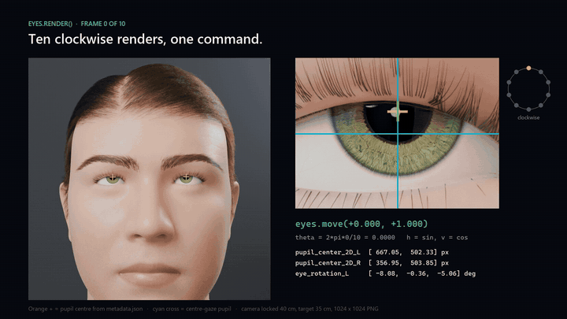
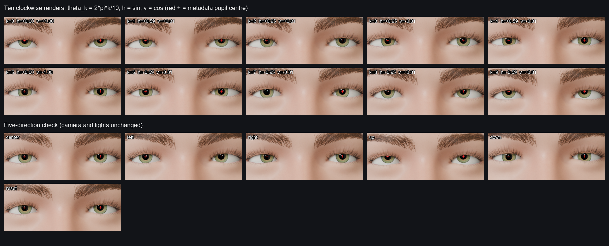

# Synthetic Eyes: Eye Movement & Virtual Camera Rendering

**Samsung XR Hackathon 2026, Track 1 (XR Perception Group)**<br>
Team **SRMIST_Rocklef**: Sree Rohith Balaji and Thackshanaramana, SRM Institute of Science and Technology

[](https://github.com/rocklef/xr-hackathon-track1-gaze/actions/workflows/track1-checks.yml)


Photoreal synthetic eyes built brick by brick in Blender: a textured, articulatable head whose eyeballs rotate in 3D about their own centres, converge on a
fixation target 35 cm ahead, and are rendered by a camera locked 40 cm ahead, with per-frame ground truth.

## Watch

| Project demo (2:56) | Wrapper in action (1:04) |
|---|---|
| [](https://cdn.jsdelivr.net/gh/rocklef/xr-hackathon-track1-gaze@main/demo/web/Project_Demo_720p.mp4) | [](https://cdn.jsdelivr.net/gh/rocklef/xr-hackathon-track1-gaze@main/demo/Wrapper_Demo.mp4) |
| [**▶ Play the project demo in your browser**](https://cdn.jsdelivr.net/gh/rocklef/xr-hackathon-track1-gaze@main/demo/web/Project_Demo_720p.mp4)<br>The problem, applications, textures, eye motion, Timeline expression, architecture and results.<br>Full 1080p: [`demo/Project_Demo.mp4`](https://github.com/rocklef/xr-hackathon-track1-gaze/raw/main/demo/Project_Demo.mp4) (download) | [**▶ Play the wrapper demo in your browser**](https://cdn.jsdelivr.net/gh/rocklef/xr-hackathon-track1-gaze@main/demo/Wrapper_Demo.mp4)<br>`eyes.move` / `eyes.reset` / `eyes.render`, the 10 clockwise frames with their metadata, the five-direction check.<br>File: [`demo/Wrapper_Demo.mp4`](https://github.com/rocklef/xr-hackathon-track1-gaze/raw/main/demo/Wrapper_Demo.mp4) (download) |

Click a preview to play the video in your browser. Every scene is also available on its own in
[`demo/clips/`](demo/clips/). Slides: [`presentation/SRMIST_Rocklef.pdf`](presentation/SRMIST_Rocklef.pdf) (opens in
the browser).



## Track 1 deliverables

| Required (track slides 5-7) | Where |
|---|---|
| Submission bundle `team_name.zip` | [`SRMIST_Rocklef.zip`](SRMIST_Rocklef.zip), and unpacked in [`bundle/`](bundle/) |
| Complete `.blend` scene: textured mesh, eye bones, materials | [`bundle/scene.blend`](bundle/scene.blend) |
| Python wrapper `eyes.move(h, v)` / `eyes.reset()` / `eyes.render()` | [`bundle/wrapper/eyes.py`](bundle/wrapper/eyes.py) |
| 10 clockwise renders, θk = 2πk/10, h = sin θk, v = cos θk, starting at the top | [`bundle/renders/`](bundle/renders/) (1024 × 1024 PNG) |
| Per-frame JSON: inputs, eye rotations, 2D pupil centres, camera matrix | [`bundle/metadata.json`](bundle/metadata.json) |
| README with setup instructions | [`bundle/README.md`](bundle/README.md) and this file |
| Contact sheet or 1-2 min demo video | contact sheet [`quality_audit/gate0/contact_sheet.png`](quality_audit/gate0/contact_sheet.png); 1:04 wrapper video [`demo/Wrapper_Demo.mp4`](demo/Wrapper_Demo.mp4) (made by [`tools/wrapper_demo.py`](tools/wrapper_demo.py) from the bundle's own output) |

### Measured against the evaluation (100 points)

All numbers come from [`tools/check_bundle.py`](tools/check_bundle.py), which reads only the rendered PNGs and the JSON
(report: [`quality_audit/gate0/report.md`](quality_audit/gate0/report.md), 22 of 22 checks pass; the same checks re-run on GitHub at every push, see the badge above).

| Criterion | Points | Result |
|---|---|---|
| **Direction pass/fail** | 40 | **5 of 5.** Left, Right, Up and Down each move both detected pupils 9-10 px in the 1024 frame; Reset is identical to centre |
| **Calibration** | 20 | Fixation target 0.350 m forward of the eye midpoint (motion bound ±5 cm); camera locked 0.400 m forward, its axis through the eye midpoint; both lines of sight hit the target within 0.0001° |
| **Automation** | 20 | One command per task, headless; runs from a clean unzip on Blender 5.2.4 and 5.3.0 with identical metadata |
| **Sequence & metadata** | 20 | 10 frames in clockwise order, 1024 × 1024 PNG, constant lighting; every slide-7 field present; metadata pupil centres within 1.92 px of the pupils detected in the images |

## Run it

Needs only Blender 5.2 LTS (or newer). From the `bundle/` folder (or the unzipped `SRMIST_Rocklef.zip`):

```bash
blender -b scene.blend -P wrapper/eyes.py -- --sequence      # renders/frame_00..09.png + metadata.json
blender -b scene.blend -P wrapper/eyes.py -- --directions    # checks/: center, left, right, up, down, reset
blender -b scene.blend -P wrapper/eyes.py -- --move 1 0 --out right.png
```

Inside Blender (Scripting tab, with `scene.blend` open):

```python
import sys; sys.path.append(r"<bundle folder>/wrapper")
import eyes
eyes.move(0.5, -1.0)            # h, v in [-1, +1]; +h = image right, +v = up
rec = eyes.render("test.png")    # 1024 x 1024 PNG + its metadata record
eyes.reset()
```

Check any output independently: `pip install -r requirements.txt`, then `python tools/check_bundle.py bundle`.
If Cycles fails on an older NVIDIA driver, set `XR_CYCLES_DEVICE=CUDA`.

**Docker** (Linux, nothing else to install):

```bash
docker build -t rocklef-gaze .
docker run --rm -v "$PWD/out:/out" rocklef-gaze        # renders the 10 frames + checks, copies them to ./out
```

## Folder structure

```
xr-hackathon-track1-gaze/
├── SRMIST_Rocklef.zip            # Track 1 submission bundle (team_name.zip, slide-6 layout)
├── bundle/                       # the same bundle, unpacked
│   ├── scene.blend               #   textured head, eye bones, materials, locked camera, fixed lights
│   ├── wrapper/eyes.py           #   eyes.move(h, v) / eyes.reset() / eyes.render()
│   ├── renders/                  #   10 clockwise frames, 1024 x 1024 PNG
│   ├── metadata.json             #   per-frame inputs, rotations, 2D pupil centres, camera matrix
│   ├── checks/                   #   centre / left / right / up / down / reset renders
│   └── README.md                 #   setup and run instructions
├── demo/
│   ├── Project_Demo.mp4          # project demo film (2:56, 1080p) + Project_Demo.srt subtitles
│   ├── Wrapper_Demo.mp4          # wrapper in action (1:04)
│   ├── web/                      # 720p copy that plays in the browser
│   ├── clips/                    # every scene of the film as its own clip
│   └── make_demo.py, shots.py, narration.py   # how the film is built
├── presentation/                 # SRMIST_Rocklef.pptx + .pdf, and build_ppt.py
├── quality_audit/                # seam audit (all 8 sets) and gate0/ (22 independent checks, contact sheet)
├── tools/                        # build_bundle, check_bundle, make_zip, contact_sheet, wrapper_demo, ...
├── textures/                     # 8 texture sets: skin, separate left/right irises (UDIM, 4K)
├── renders_textures/             # renders of every texture set (+ eye and macro close-ups)
├── renders_eyes_cli/             # Left / Right / Generate Motion videos
├── eyes_cli.py                   # one script, inputs Left / Right / Generate Motion -> frames + video
├── eyes.py                       # full control wrapper: gaze, eyelids, blinks, pupils, brows, face shape
├── render_textures.py            # renders the texture sets
├── gnm_expression_timeline.blend # expression animated on the Blender Timeline
├── gnm_rig/                      # head build, expressions, textures, irises, hair, motion model
├── docs/                         # DETAILS.md (how everything is built) and README media
├── legacy/                       # our earlier exploration and the demo's application scenes
├── Dockerfile, requirements.txt  # headless setup
├── AI_DISCLOSURE.md, LICENSE
└── .github/workflows/            # re-runs the Track 1 checks on every push
```

## Brownie features

### Synthetic Head Modeling & Texturing evaluation (100 points)

| Rubric item | Points | Required output | Where |
|---|---|---|---|
| **Texture photorealism** | 60 | 5-10 textured UV maps, face and eyes, on the head's UV map | [`textures/`](textures/): 8 sets, each with separate left and right iris tiles |
| | | Python script that renders with the generated textures | [`render_textures.py`](render_textures.py) |
| | | 5-10 rendered images with different textures | [`renders_textures/`](renders_textures/): 8 images, plus eye and macro close-ups |
| **Kinematic accuracy** | 20 | Python script taking **Left**, **Right** or **Generate Motion**, rendering the frames and making a video | [`eyes_cli.py`](eyes_cli.py) |
| | | One video per input, each 15 s or less | [`renders_eyes_cli/`](renders_eyes_cli/): `Left.mp4` 6 s, `Right.mp4` 6 s, `Generate_Motion.mp4` 12 s |
| **Code & UV portability** | 20 | `.blend` that loads the head and animates an expression on the Timeline (eyelids, iris, eyebrows) | [`gnm_expression_timeline.blend`](gnm_expression_timeline.blend): blink, wide, squint, pupil, brows, gaze, head; open it and press **Play** |

| Workflow item (slide 1) | Where |
|---|---|
| Load the 3D head model | [`gnm_rig/build_head.py`](gnm_rig/build_head.py) |
| Face shape and expression parameters | 20 identity sliders and the lid/brow expressions: `eyes.identity(...)`, `eyes.expression(...)` in [`eyes.py`](eyes.py) |
| Eye motion: left, right, up, down | [`eyes.py`](eyes.py) `look(h, v)`; [`bundle/wrapper/eyes.py`](bundle/wrapper/eyes.py) `move(h, v)` |
| Eyelid closure, continuous and coordinated with gaze | `eyes.eyelids(open)`, lids follow vertical gaze automatically |
| UV layout texture transfer | textures baked through the head's own UVs ([`gnm_rig/textures.py`](gnm_rig/textures.py)) |
| Separate left and right iris maps | UDIM tiles 1002 (left) and 1004 (right) in every set, all different |
| Photorealistic quality audit: seams and artefacts | [`quality_audit/`](quality_audit/README.md): numeric seam check, every set passes |

Beyond these, the head is built for photorealism:

- **8 photoreal texture sets** on the head's UV layout (skin, separate left and right irises, teeth), seam-free by
  construction: [`textures/`](textures/), renders in [`renders_textures/`](renders_textures/), seam audit in
  [`quality_audit/`](quality_audit/README.md).
- **3D hair**: head hair, brows, lashes, stubble and fine facial hair, all bound so nothing drags across the eye.
- **Natural eye motion** with saccades, fixation drift, blinks and lids that follow the gaze:
  [`eyes_cli.py`](eyes_cli.py) renders the inputs Left, Right and Generate Motion to
  [`renders_eyes_cli/`](renders_eyes_cli/).
- **An expression on the Blender Timeline**: [`gnm_expression_timeline.blend`](gnm_expression_timeline.blend)
  (eyelids, pupils, brows and gaze; open it and press Play).
- **A richer control wrapper** for the full rig: [`eyes.py`](eyes.py) (gaze, eyelids, blinks, pupils, brows and
  20 identity sliders).

- **Application scenes** where synthetic eyes matter, rendered in Blender with the same eye rig:
  VR foveated rendering, driver monitoring, eye typing and early autism screening.

Every scene of the demo is also available as its own clip in [`demo/clips/`](demo/clips/):

| Clip | Shows |
|---|---|
| [`app_vr.mp4`](demo/clips/app_vr.mp4) | Virtual reality: a headset sharpens only where the user looks |
| [`app_car.mp4`](demo/clips/app_car.mp4) | Driver monitoring: the car warns when the driver's eyes leave the road |
| [`app_access.mp4`](demo/clips/app_access.mp4) | Eye typing: a person who can't speak types "HELLO SAM" with their eyes |
| [`app_medical.mp4`](demo/clips/app_medical.mp4) | Early screening: a child's gaze on a screen game |
| [`orbit.mp4`](demo/clips/orbit.mp4) | The textured head with hair, turning in studio light |
| [`identity.mp4`](demo/clips/identity.mp4) | Face-shape sliders changing the face while the eyes stay seated |
| [`timeline.mp4`](demo/clips/timeline.mp4) | The Timeline expression: surprise, squint, eye-roll, blink |

How everything is built: [`docs/DETAILS.md`](docs/DETAILS.md).

## Submission checklist

| Item | Where |
|---|---|
| Submission package (as per the theme slides) | [`SRMIST_Rocklef.zip`](SRMIST_Rocklef.zip) |
| Source code | [`bundle/wrapper/`](bundle/wrapper/), [`tools/`](tools/), [`gnm_rig/`](gnm_rig/), [`eyes_cli.py`](eyes_cli.py), [`eyes.py`](eyes.py), [`render_textures.py`](render_textures.py) |
| Presentation | [`presentation/SRMIST_Rocklef.pdf`](presentation/SRMIST_Rocklef.pdf) (view in browser) and [`.pptx`](presentation/SRMIST_Rocklef.pptx) |
| Video | demo film [`demo/Project_Demo.mp4`](demo/Project_Demo.mp4) (2:56); wrapper demo [`demo/Wrapper_Demo.mp4`](demo/Wrapper_Demo.mp4) (1:04); every scene in [`demo/clips/`](demo/clips/) |
| AI disclosure | [`AI_DISCLOSURE.md`](AI_DISCLOSURE.md) |
| README | this file, [`bundle/README.md`](bundle/README.md), [`docs/DETAILS.md`](docs/DETAILS.md) |
| Docker, requirements, licence, CI | [`Dockerfile`](Dockerfile), [`requirements.txt`](requirements.txt), [`LICENSE`](LICENSE) (MIT), [`.github/workflows/track1-checks.yml`](.github/workflows/track1-checks.yml) |
| APK / SDK | not applicable (no app); the Python wrapper is the programmable interface |

## Credits and licences

- Base head mesh, identity decoder and UV layout: Google GNM v3, Apache-2.0 ([github.com/google/GNM](https://github.com/google/GNM)). Everything else (textures, eyes, hair, rig, expressions, motion, wrapper, verification, renders) was built by Team Rocklef.
- All textures, rig, expressions, motion and rendering code here were written for this submission.
- Studio lighting HDRI: Blender's bundled `interior.exr` (CC0).
