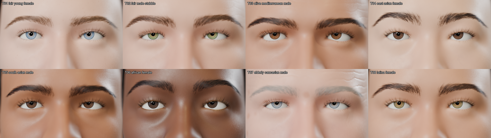

# Synthetic Eyes on GNM: photoreal textures and natural eye motion

**Samsung PRISM Hackathon 2026, XR Perception Group, 3D Assets Track**<br>
Team Rocklef: Sree Rohith Balaji and Thackshanaramana, SRM Institute of Science and Technology

Built on **Google's GNM v3 head model**: every texture wraps directly onto GNM's topology and UV layout.



## What the evaluation asks for, and where it is

| Rubric item | Points | Required output | Where |
|---|---|---|---|
| **Texture photorealism** | 60 | 5-10 textured UV maps, face and eyes, on the GNM UV map | [`textures/`](textures/): 8 sets (T01-T08) |
| | | Python script that renders with the generated textures | [`render_textures.py`](render_textures.py) |
| | | 5-10 rendered images with different textures | [`renders_textures/`](renders_textures/): 8 images |
| **Kinematic accuracy** | 20 | Python script taking the input **Left**, **Right** or **Generate Motion**, rendering the frames and making a video | [`eyes_cli.py`](eyes_cli.py) |
| | | One video per input, each 15 s or less | [`renders_eyes_cli/`](renders_eyes_cli/): `Left.mp4` (6 s), `Right.mp4` (6 s), `Generate_Motion.mp4` (12 s) |
| **Code & UV portability** | 20 | `.blend` that loads the head and animates an expression (eyelids, iris, eyebrows) on the Timeline | [`gnm_expression_timeline.blend`](gnm_expression_timeline.blend): open it and press **Play** |

Slide 1 deliverables:

| Deliverable | Where |
|---|---|
| Rendered video of natural eye and eyelid motion | the three videos above |
| 5-10 UV skin texture maps for GNM | [`textures/`](textures/) |
| Python control wrapper for gaze and eyelid opening/closing | [`eyes.py`](eyes.py) |
| Face shape and expression parameters | 20 GNM identity sliders on every head: `eyes.identity(ID_00=1.5)` |
| Separate left and right iris maps | UDIM tiles 1002 (left) and 1004 (right) in every set |
| Quality audit for seams and artefacts | [`quality_audit/`](quality_audit/README.md): every set passes |

## Submission checklist

| Item | Where |
|---|---|
| Submission package (as per the theme slides) | the deliverables in the tables above |
| Source code | [`render_textures.py`](render_textures.py), [`eyes_cli.py`](eyes_cli.py), [`eyes.py`](eyes.py), [`gnm_rig/`](gnm_rig/), [`tools/`](tools/) |
| Presentation | [`presentation/`](presentation/) |
| Video | demo: [`demo/SRMIST_Rocklef_demo.mp4`](demo/SRMIST_Rocklef_demo.mp4) (2 min 43 s); rubric videos: [`renders_eyes_cli/`](renders_eyes_cli/) |
| AI disclosure | [`AI_DISCLOSURE.md`](AI_DISCLOSURE.md) |
| README | this file; technical details in [`docs/DETAILS.md`](docs/DETAILS.md) |
| APK / SDK | not applicable (no app). The Python control wrapper [`eyes.py`](eyes.py) is the programmable interface; [`Dockerfile`](Dockerfile) runs everything headless |

## Run it

Needs Blender 5.2 LTS (or 5.3), Python 3.10+ and ffmpeg. Run from the repository root.

```bash
# Texture photorealism: render each texture set
blender -b --factory-startup gnm_rig/out/heads/T03.blend -P render_textures.py -- --tex T03 --views portrait,eyes,macro
blender -b --factory-startup gnm_rig/out/gnm_head.blend  -P render_textures.py -- --tex all

# Kinematic accuracy: one input, frames + video in renders_eyes_cli/
python eyes_cli.py --input "Left"
python eyes_cli.py --input "Right"
python eyes_cli.py --input "Generate Motion"

# Control wrapper: gaze in degrees, eyelid opening 0..1
blender -b --factory-startup gnm_rig/out/heads/T02.blend -P eyes.py -- --look 18 6 --eyelids 0.6 --render out.png
```

If Cycles fails on an older NVIDIA driver, set `XR_CYCLES_DEVICE=CUDA`. Blender's path can be given with
`--blender PATH` or the `XR_BLENDER` environment variable.

**Docker** (Linux, nothing else to install):

```bash
docker build -t rocklef-gaze .
docker run --rm -v "$PWD/out:/out" rocklef-gaze python3 eyes_cli.py --input Left --out /out
```

## More

- [`docs/DETAILS.md`](docs/DETAILS.md): how the textures, eyes, hair, motion and rig are made.
- [`gnm_rig/`](gnm_rig/README.md): the build scripts.
- [`demo/`](demo/): the demo video.

## Credits and licences

- **GNM v3** head model, identity decoder and UV layout: Google, Apache-2.0 ([github.com/google/GNM](https://github.com/google/GNM)).
- All textures, rig, expressions, motion and rendering code here were written for this submission.
- Studio lighting HDRI: Blender's bundled `interior.exr` (CC0).
